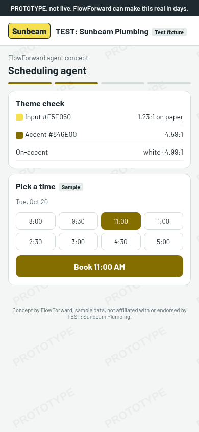
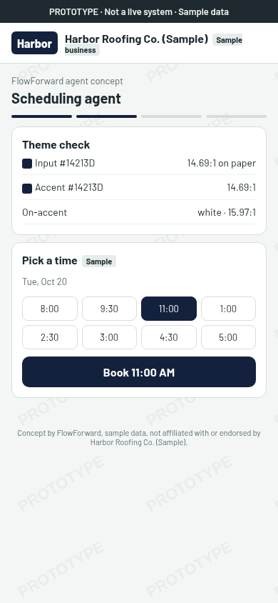
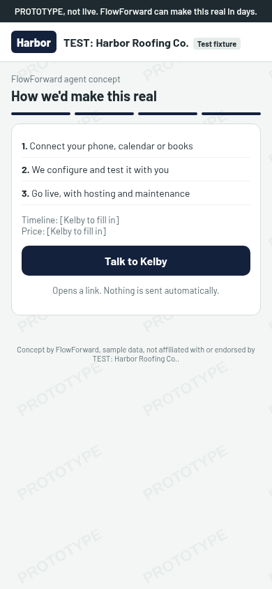
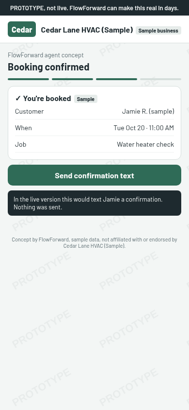
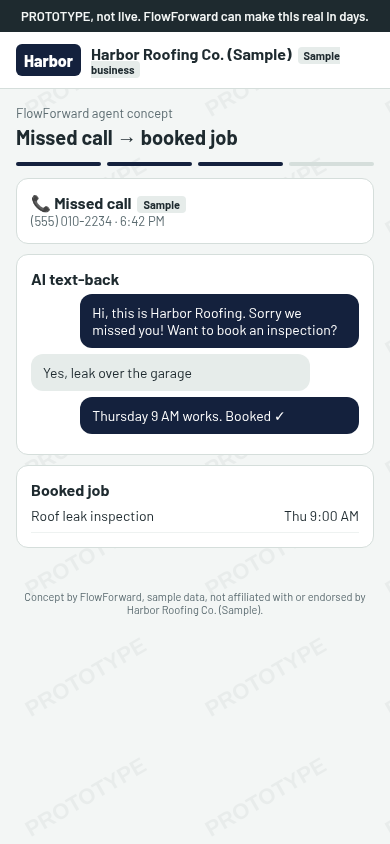
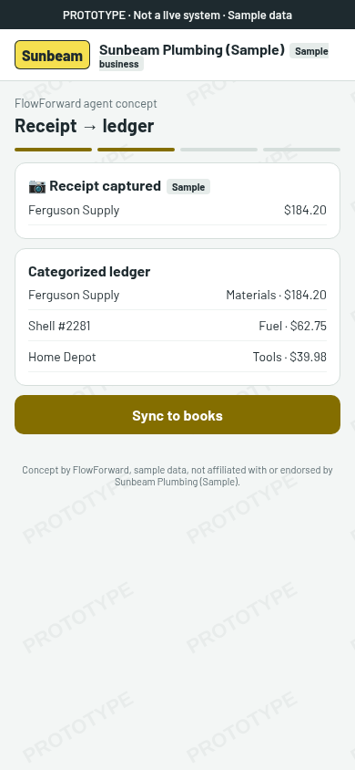
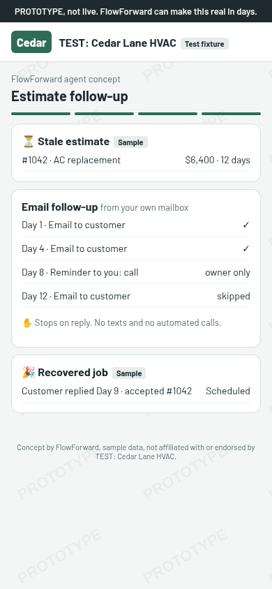

# FlowForward Prototype Design System

Branded clickable prototypes of FlowForward agents (scheduling, call, bookkeeping, estimate follow-up). Each one re-skins to a prospect's business-name wordmark and brand color (no logos). **This is a spec only.** Delta implements it.

## 1. Theme tokens

**Inputs:** `businessName`, `brandPrimary` (hex, optional), `brandSecondary` (hex, optional). There is **no logo input**: real logos are not approved (Kelby's decision), so the only brand mark is the wordmark (see §2 Brand mark). The spec defines no `logo`, `logoUrl`, upload or manual-logo option, and nothing is fetched from the prospect's site.

> **Deprecation note (current code):** `logoUrl` is still accepted (https only, no credentials) and stored, and the prototype can render one bundled synthetic TEST mark (`bundled:test-wasatch-heating`); both are deprecated and unused per Kelby's Oct 16 decision (wordmark only) until a code PR removes them. Prototypes built from this spec must not use either.

**Neutral FlowForward chrome (River Valley), fixed:**

| Token | Value |
|---|---|
| `ff.juniper` | #2F6B57 (fallback accent) |
| `ff.ochre` | #C9952F (FlowForward highlights only, never the brand) |
| `ff.slate` | #1E2A2F |
| `ff.paper` | #F3F6F5 |
| font | Barlow (400/600/700), system-ui fallback |

**Semantic tokens:**

| Token | Source | Notes |
|---|---|---|
| `surface` | paper #F3F6F5 / cards #FFFFFF | never brand |
| `on-surface` | slate #1E2A2F | |
| `muted` | #5B6B70 | secondary text (≥4.5:1 on white) |
| `border` | #D5DEDB | |
| `accent` | `fixAccent(brandPrimary)` | buttons, selected states, progress, outgoing bubbles |
| `on-accent` | white or slate | whichever contrasts more with `accent` |
| `accent-2` | `fixAccent(brandSecondary)` | optional, used only for small decoration |

The brand color goes on accents only. Surfaces stay neutral, so any brand looks premium.

## 2. Contrast safeguards (algorithm)

**Contrast rule (ordered steps).** Surfaces are always light (paper #F3F6F5 / white), so the rule only ever darkens:

1. **Validate.** If `brandPrimary` is missing or not a valid hex, use juniper #2F6B57 and stop.
2. **Cap chroma.** Convert to OKLCH (L, C, H) and set `C = min(C, 0.20)` to tame neon or oversaturated colors.
3. **Darken at the same hue.** Lower L in steps of 0.01, keeping C (gamut-clipped) and H, until contrast is **≥ 4.5:1 against paper AND ≥ 4.5:1 against white**. The result is `accent`.
4. **Fall back.** If L reaches 0.05 with no passing value, use juniper #2F6B57.
5. **On-accent text.** `onAccent = contrast(accent, #FFFFFF) >= contrast(accent, #1E2A2F) ? #FFFFFF : #1E2A2F`. It must also be ≥ 4.5:1; if neither is, use juniper as the accent with white text.

**Thresholds.** `accent` always meets 4.5:1 because it carries text (buttons, links, selected slots with labels, chat bubbles). The 3:1 threshold applies **only to UI-only, non-text elements**: borders, progress bars, focus rings, icons without text, and selected-state fills that carry no text. Anything with text on it needs 4.5:1. Because step 3 already targets 4.5:1, a single `accent` token is valid for both.

The surfaces are always light, so in practice this darkens. Hue is preserved, so the brand still reads as itself. Worked examples, rendered in the mockups:

| Input | Raw on paper | Accent | Accent contrast | On-accent |
|---|---|---|---|---|
| #F5E050 yellow | 1.23:1 ✗ | #7D7000 | 4.61:1 on paper ✓ | white 5.01:1 |
| #14213D navy | ~14:1 ✓ | #14213D (unchanged) | ✓ | white |
| none / invalid hex | — | #2F6B57 juniper | ✓ | white |

**Brand mark: wordmark only (v1)**
- **The wordmark is the sole brand mark.** Real logos are **not approved** (Kelby's decision). The header shows `businessName` (with the `TEST:` prefix stripped) as text on an `accent` plate with `onAccent` text, plus the brand colors. There are no logo fixtures, no logo upload, no manual-logo entry, and no logo fallback state.
- **No remote fetch, ever.** Prototypes never fetch anything (logos, images, colors) from a prospect's website or any remote URL on the server; that's an SSRF risk. Brand colors are entered as hex values.
- **Wordmark plate:** the wordmark always sits on the corrected `accent` with `onAccent` text, never on the raw brand color (e.g. yellow #F5E050 renders as #7D7000 with white text). Plate padding is 4px 8px, radius 6px, height 32px (mobile) / 40px (desktop).

## 3. Layout

Mobile-first at **390px**, desktop at **1280px**. On desktop the flow sits in a centered 720px column, with the CTA panel as a 360px sticky right rail.

**Shared shell (top → bottom):** watermark ribbon → branded header (wordmark + business name + "Sample business" tag) → agent title + subtitle → step progress (3–5 segments, clickable back/next) → screen content → CTA panel (after the final step on mobile, right rail on desktop) → footer.

**Key screens per agent:**
- **Scheduling:** booking calendar (slot grid) → confirmation summary.
- **Call agent:** missed call card → AI text-back conversation → booked job.
- **Bookkeeping:** receipt capture → categorized ledger → "sync to books" (toast).
- **Estimate follow-up (EMAIL-ONLY, from the owner's own mailbox):** stale estimate → 3–4 email touches that **stop when the customer replies** (e.g. Day 1 email, Day 4 email, Day 8 "Reminder to you: call", Day 12 email) → recovered job. No SMS/texts. A call may appear only as a reminder to the owner, never as an automated customer call. Show a "Stops on reply" note. This matches #40 (Pilot #1 is email-only).

## 4. Watermark (non-removable)

Rendered by `PrototypeWatermark` from the prototype shell, **outside theme/brand props**. **Flag (per #40):** `FF_PROTOTYPE_GALLERY` gates **all** prototype routes and generators and defaults to **OFF in production**. It never affects the watermark: whenever a prototype renders, the watermark renders. No flag, theme or query param can turn it off.

- **Ribbon:** exactly "PROTOTYPE, not live. FlowForward can make this real in days." (Summit-required wording; do not paraphrase). `position: sticky; top: 0`, min-height 32px and grows to fit up to two lines at 390px (padding 6px 12px, centered, line-height 1.3), Barlow 600 at 13–14px, slate #1E2A2F background, paper #F3F6F5 text (never brand colors), `role="note"`, no close button.
- **Tiled pattern:** diagonal (−30°) "PROTOTYPE" SVG tile behind content at ~5% opacity (range 4–6%), `pointer-events: none`.
- **No ROI or close-rate promises** (from #40), anywhere: copy, demo, or proposal. No invented ROI, revenue-recovered, or savings figures in prototypes. Use conditional wording only ("could", "shops like yours often").
- **No real names:** vendors, brands, companies and people in mockups and fixtures are fictional (e.g. "Sample Pipe Supply", "Sample Fuel Stop"). Every ledger row, call record, message and booked job carries a Sample tag.
- **Fixture naming:** fixture business names use a `TEST:` prefix (e.g. `TEST: Cedar Lane HVAC`). Fixtures prefer HVAC (primary) and plumbing (secondary), per #40's target. Real prospect names never go into fixtures, and there are no logo fixtures.
- **Sample tags:** every fake datum (customer, amount, phone, business) carries a "Sample" tag or a "(sample)" suffix. Phone numbers use the 555-01xx range, e.g. (801) 555-0142.
- **Footer:** "Concept by FlowForward, sample data, not affiliated with or endorsed by <Business>. This preview link expires 14 days after it was shared."
- **No real actions:** every acting button shows a toast, "In the live version this would …". No network sends.
- **Injection-safe:** `businessName` and all brand strings are rendered as escaped text, never as HTML. A business name containing markup must not be able to remove or hide the watermark.
- **Guarantee:** the watermark is server-rendered markup and tests assert it is present and visible under hostile colors, markup in the business name (e.g. ``, `
<script>`), very long names, `?watermark=0`, every flag combination, and theme overrides. CSS can't stop DevTools removal; the server markup plus the tests are the guarantee.

## 5. "How we'd make this real" CTA panel

1. Connect your phone, calendar or books.
2. We configure and test it with you.
3. Go live, with hosting and maintenance.

**Price anchors** (Kelby's numbers; always phrased conditionally, as typical starting ranges, never guarantees):
- Prototype: **$0**.
- MVP build: typically **$1.5–3.5K**.
- Hosting and maintenance: typically **$150–400/mo**.
- Consulting: typically **$125–200/hr**.

Show them with the qualifier "Typical starting ranges; final scope after a call."

**Case-study discount:** the first build may be discounted in exchange for a case study. State this without a number (no discount percentage or amount).

Apart from the four anchors above and this unnumbered discount note, add no other prices or figures. No ROI, savings, revenue-recovered or close-rate promises.

**Link expiry:** prototype links expire **14 days** after they're shared. The CTA panel and footer both say so, e.g. "This preview link expires 14 days after it was shared."
One primary button, **"Talk to Kelby"**, which is a plain link (`<a href>`, e.g. a booking page or `mailto:`). It never sends email automatically or submits a form.

## 6. Acceptance checklist (Delta's PR)

- [ ] Tokens implemented; brand color appears only on accent elements.
- [ ] Contrast unit tests: #F5E050 → #7D7000 (4.61:1 on paper, 5.01:1 on white), #14213D unchanged, neon (#00FF00, #FF00FF) chroma-capped, invalid/missing → juniper.
- [ ] `onAccent` picks the higher-contrast option of white or slate.
- [ ] Wordmark is the only brand mark: no logo input, fixture, upload or manual-logo option; no remote fetch of any kind (asserted in the test).
- [ ] Wordmark plate uses `accent`/`onAccent`, never the raw brand color.
- [ ] Prototype links expire 14 days after sharing; CTA and footer state the expiry.
- [ ] **Required test:** a business name containing `` or `
<script>` is escaped (appears as literal text), and the ribbon, tile and footer remain present and visible.
- [ ] Estimate follow-up demo is email-only (3–4 touches, stops on reply, call shown only as an owner reminder).
- [ ] Fixture names use the `TEST:` prefix; no real vendor, brand, company or person names; Sample tags on all fake data rows.
- [ ] No ROI, revenue-recovered, savings or close-rate claims anywhere in prototype copy.
- [ ] `FF_PROTOTYPE_GALLERY` gates all prototype routes and generators, defaults OFF in prod; the watermark renders regardless of flag state whenever a prototype renders.
- [ ] Watermark ribbon + tile + footer present; tests cover hostile colors, `?watermark=0`, flags, and theme overrides.
- [ ] Ribbon has `role="note"` and no close control.
- [ ] Every action button shows a toast; no outbound requests (asserted in the test).
- [ ] CTA shows the four conditional price anchors (prototype $0, MVP $1.5–3.5K, hosting $150–400/mo, consulting $125–200/hr) with the "typical starting ranges, final scope after a call" qualifier and no guarantees, plus the unnumbered first-build case-study discount note; "Talk to Kelby" is an `<a>`.
- [ ] Layout verified at 390 and 1280; axe shows no contrast violations.

**Screenshot proof list:** each of the 4 agents at 390 and 1280; yellow (#F5E050) and navy (#14213D) themes; the no-brand-color (juniper) state; a toast visible; the CTA panel; `?watermark=0` still showing the watermark.

## Mockups (390px)

| | |
|---|---|
|  |  |
|  |  |
|  |  |
|  | |
